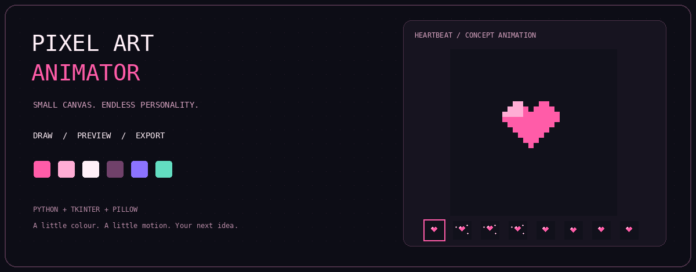

<div align="center">



# Pixel Art Animator

### Small canvas. Endless personality.

A local desktop editor for drawing pixel art, exploring frame-by-frame animation,
and exporting your ideas as GIFs or PNG spritesheets.

`Python` · `Tkinter` · `Pillow` · `MIT licensed`

[Get started](#get-started) · [Make your first loop](#your-first-animation) · [Tools](#the-toolbox) · [Exports](#export-your-work) · [Project format](#project-file-format)

</div>

---

## A little colour. A little motion. Your next idea.

A blinking character. A bouncing heart. A tiny sprite with a big personality.

Pixel Art Animator is a personal Python desktop project that brings drawing,
frame previews, colour palettes, and image exports into a single Tkinter interface.
Use it to experiment with pixel art, study animation one frame at a time, or build
small visual assets for your next project.

The editor runs locally. Once Python, Tkinter, and Pillow are installed, its
editing and export operations do not require an internet connection or an account.

> Project status: experimental. Features are documented from the repository source,
> not from a completed cross-platform test suite. See the current limitations below.

## See the idea in motion

<div align="center">

</div>

This is an illustrative animation supplied with this documentation pack—not a
screen recording or a claim that it was exported by the application.

Open [the editable heartbeat project](examples/heartbeat.json) in the app to inspect
its eight 32 × 32 frames. A [matching sample spritesheet](examples/heartbeat-spritesheet.png)
is included, with all eight frames arranged horizontally.

## The toolbox

| Area | What the source provides |
| :--- | :--- |
| Drawing | Pencil, eraser, and flood-fill tools. |
| Colour | A starting palette and a colour picker for adding colours. |
| Canvas | A 32 × 32 default project, configurable dimensions, zoom, and an optional grid. |
| Selection | Rectangular selection and movement handlers, plus a clear-selection action. |
| Animation | Frame thumbnails, playback, FPS control, looping, and an onion-skin toggle. |
| Frame controls | Add, duplicate, delete, and reorder controls; some handlers contain placeholder code and need verification. |
| Editing history | Undo/redo buttons and pixel snapshot history. |
| Notes | Per-frame notes stored with project data. |
| Files | Save/load JSON projects, recent-project tracking, and autosave draft support. |
| Export | Animated GIFs and PNG spritesheets with scaling options. |
| Interface | A pink-themed Tkinter desktop UI. |

## Get started

### 1. Clone the repository

```bash
git clone https://github.com/Hameem-Bhai/Pixel-Art-Animator.git
cd Pixel-Art-Animator
```

### 2. Create an isolated Python environment

Use a supported Python 3 installation with Tkinter available. An exact minimum
Python version has not been established by compatibility testing.

```bash
python -m venv .venv
```

Windows PowerShell:

```powershell
.venv\Scripts\Activate.ps1
```

macOS / Linux:

```bash
source .venv/bin/activate
```

### 3. Install the runtime dependency

The editor imports Pillow for image handling; Tkinter comes from your Python /
operating-system installation, not from a normal pip package.

```bash
python -m pip install Pillow
```

The repository also contains a broader dependency list named `requirments.txt`
(the spelling is intentional here because it matches the current filename):

```bash
python -m pip install -r requirments.txt
```

That file includes extra development and multimedia packages. They are not all
required by the editor's visible import list. Choose the minimal Pillow install
for a straightforward launch, or the full list when working on the repository.

### 4. Launch the editor

```bash
python pixel_animator.py
```

If PowerShell blocks environment activation, use the environment directly:

```powershell
.venv\Scripts\python.exe -m pip install Pillow
.venv\Scripts\python.exe pixel_animator.py
```

### Check Tkinter separately

```bash
python -m tkinter
```

A small demonstration window should open. If Tkinter is unavailable, install the
Tk support appropriate to your Python distribution. For Ubuntu / Debian's system
Python, that commonly means:

```bash
sudo apt install python3-tk
```

This is a desktop GUI: it needs a graphical session, not just a headless terminal.

## Your first animation

### Start with the supplied sample

1. Launch the editor.
2. Choose File → Open and select `examples/heartbeat.json`.
3. Click the timeline thumbnails to inspect the poses and frame notes.
4. Set the playback FPS to `8`, enable Loop, and click Play.
5. Stop playback before editing. Try changing the heart's colours or a few pixels.
6. Save As a new JSON project so the original example remains intact.
7. Try Export GIF or Export Spritesheet.

The sample is provided in the app's serialized project format. Loading and playback
still need testing on your machine; the documentation assets were generated separately.

### Draw something of your own

- Use New for a canvas-size prompt, or File → New Paint to choose a background colour too.
- Choose a palette colour and draw with Pencil; use Fill for connected regions.
- Use the Grid and Zoom controls for precise placement.
- Save a project before experimenting further.
- The frame toolbar is intended for building a sequence, but verify its operations
  against the current build before relying on it for longer work.

The eraser restores the project's background colour; it is not a transparent-pixel brush.

## Export your work

| Output | Options | Use it for |
| :--- | :--- | :--- |
| JSON project | Palette, dimensions, FPS, background index, frame images, notes | Reopening and editing later. |
| Animated GIF | 1–60 FPS prompt, 1–16× scale, loop setting | README animations and small visual loops. |
| PNG spritesheet | Column count, 1–32× scale, 0–64 px padding | Sprite sequences and asset workflows. |

Export scale enlarges the pixel artwork; it is separate from the editor's canvas zoom.
GIF uses a palette-based format, so colour conversion may affect the result.

The code represents drawn pixels as palette colours rather than storing per-pixel
alpha. Do not assume transparent sprites or a transparent GIF background. PNG
spritesheet padding is created on a transparent sheet, but the individual frame
images retain their background colour.

The GIF writer uses `loop=0` when Loop is enabled and `loop=1` when it is disabled.
The latter can encode a repeat rather than strict play-once behavior; test playback
in your target viewer if this distinction matters.

## Project file format

Projects are JSON documents with version metadata and a list of frames. Each frame
is stored as a Base64-encoded PNG, accompanied by its index and an optional note.

```json
{
  "version": 1,
  "meta": {
    "width": 32,
    "height": 32,
    "fps": 8,
    "palette": ["#11111b", "#ff5ca8"],
    "bg_index": 0
  },
  "frames": [
    {
      "index": 0,
      "png_base64": "<base64-encoded PNG data>",
      "note": "First pose"
    }
  ]
}
```

This is a schematic example; use `examples/heartbeat.json` for a complete loadable
file. Base64 images make projects self-contained, but can produce larger files than
a compact pixel-index-only format.

## Saving and recovery

| File | Purpose |
| :--- | :--- |
| Your chosen `.json` file | Manually saved, editable project. |
| `pixel_animator_autosave.json` | Local draft written after dirty edits trigger autosave. |
| `recent_projects.json` | Up to ten recent project paths. |

The draft and recent-project files are written beside the script. Use a writable
folder. File → Open Draft attempts to reopen the autosave; this is not a substitute
for manual saves or versioned backups. Recent-project data can contain local paths,
so avoid committing it accidentally.

## How it is built

```text
Tkinter controls and canvas events
              |
              v
PixelAnimator application state
  palette + flat pixel-index arrays + frame notes
              |
              v
Pillow images
  project PNG encoding / GIF export / spritesheet assembly
```

The application currently lives in one main module. That makes it approachable to
read, while separating drawing logic, serialization, export, and UI would be useful
future refactoring work.

```text
Pixel-Art-Animator/
├── pixel_animator.py
├── requirments.txt
├── setup.py
├── LICENSE
├── README.md
├── docs/
│   └── assets/
│       ├── pixel-animator-banner.gif
│       └── heartbeat-preview.gif
└── examples/
    ├── heartbeat.json
    └── heartbeat-spritesheet.png
```

The `docs` and `examples` folders above are supplied by this README pack.

## Troubleshooting

| Symptom | What to check |
| :--- | :--- |
| `No module named PIL` | Run `python -m pip install Pillow` using the same interpreter that launches the app. |
| `No module named tkinter` | Install Tk support for your Python distribution; pip-installing Pillow will not add Tk. |
| No display / `$DISPLAY` error | Run in a graphical desktop session. |
| A frame button has no effect | Some frame handlers contain placeholder code; this may be an implementation gap rather than a setup problem. |
| Draft or recent projects do not save | Make sure the script's folder is writable. |
| Art looks unexpectedly large | Reduce canvas zoom or use smaller dimensions. |
| An exported GIF differs from the canvas | Check export scaling, background colour, GIF palette conversion, and viewer loop behavior. |

When reporting a bug, include your OS, Python and Pillow versions, steps to
reproduce it, expected behavior, and any error text. Attach a minimal example
project when possible, without private local paths or personal artwork.

## Current limitations and useful next steps

- Frame-management handlers include placeholder implementations; validate and complete them.
- Undo/redo should be tested across drawing, selection movement, frame changes, and project loads.
- Draft recovery and unsaved-change prompts need edge-case testing.
- Very large canvases or many frames can make the current canvas / thumbnail layout unwieldy.
- Lasso-related code exists, but there is no exposed lasso tool in the current UI.
- No claim is made here of automated test coverage, packaged installers, or verified OS compatibility.

Potential improvements—not shipped features—include keyboard shortcuts, transparent
pixels, a scrollable timeline, import workflows, and regression tests for project
round trips and exports.

## Contributing

Issues and focused pull requests are welcome. For code changes:

1. Explain the problem before expanding the feature set.
2. Keep unrelated formatting out of the change.
3. Test a fresh project and an existing JSON file.
4. Check save → reload → playback → export for regressions.
5. Document any change to project-file compatibility.

## License

Released under the [MIT License](LICENSE). Copyright © 2026 Hameem.
Retain the required copyright and license notices when redistributing the software.

---

<div align="center">

Made by [Hameem](https://github.com/Hameem-Bhai).

**Make something tiny. Give it a little life.**

</div>
